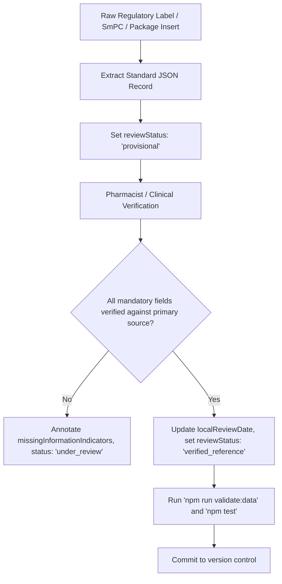

# MediGuide AI — Reference Medicine Data Curation Guide

## 1. Principles of Medical Data Integrity

MediGuide AI strictly prioritizes patient safety and factual veracity over coverage breadth.
Under no circumstances should automated scrapers, generative LLMs, or unverified online sources ingest data directly into production without clinical verification.

### Core Safety Rules
1. **Never Invent Medical Facts**: Never generate plausible-sounding medical data, warnings, side effects, or dosages.
2. **Distinction of Absence vs Unknown**:
   - `verified_present`: Explicitly documented in authoritative label.
   - `verified_absent`: Specifically evaluated and confirmed absent (e.g., "no gluten in formulation" or "no contraindication for pediatric use above age 2").
   - `unknown`: Not documented or researched in standard literature.
   - `not_assessed`: The referenced authority explicitly did not evaluate this risk or indication.
   - `unavailable`: The consulted document does not provide this section.
3. **No Risk-Absence Inference**: Missing information must **never** be treated as evidence that a risk or adverse effect does not exist.
4. **Source Provenance Mandatory**: Every entry must cite the exact regulatory authority or pharmacopeial document and record the date of local human review.

---

## 2. Authoritative Primary Sources

Permissible clinical reference sources:
- **DailyMed / FDA Structured Product Labeling (SPL)** (US FDA)
- **European Medicines Agency (EMA)** Summary of Product Characteristics (SmPC)
- **Central Drugs Standard Control Organisation (CDSCO)** Approved Drug Lists (India)
- **British National Formulary (BNF)** / NICE guidelines
- **Health Canada Drug Product Database**

---

## 3. Human Review & Verification Workflow



### Step 1: Draft Creation (`provisional`)
1. Create a record following `src/types/medicine.ts`.
2. Assign a stable ID (e.g., `fda-spl-paracetamol-500mg-tab`).
3. Set `isTestFixture: false` and `reviewStatus: "provisional"`.
4. Fill in `sourceProvenance` with:
   - `sourceTitle`: Full title of the official label or monograph.
   - `organization`: Regulatory agency (e.g., "US FDA", "EMA").
   - `documentIdentifierOrUrl`: Set ID, NDA/ANDA number, or permanent URL.
   - `publicationOrRevisionDate`: Publication/revision date indicated on the label.
   - `localReviewDate`: Date the entry was transcribed (YYYY-MM-DD).

### Step 2: Verification Checklist (`verified_reference`)
Before changing `reviewStatus` to `verified_reference`:
- [ ] Active ingredients, strengths, and units match label word-for-word.
- [ ] All brand names are verified in the jurisdiction's registration database.
- [ ] Serious boxed warnings and contraindications are verified against the latest revision.
- [ ] Any field not explicitly addressed in the label is marked `unknown`, `not_assessed`, or `unavailable` and listed in `missingInformationIndicators`.
- [ ] Verify that `isTestFixture` is `false`.

### Step 3: Automated Validation
Run dataset validation:
```powershell
npm run validate:data
npm test
```
Records failing validation or containing duplicate IDs will be rejected by the validation pipeline.

---

## 4. Test Fixtures Isolation Policy

- Synthetic test fixtures must always carry:
  - `"isTestFixture": true`
  - `"reviewStatus": "test_fixture"`
  - Generic names prefixed with `"Test-"`
- Production search queries exclude test fixtures by default (`includeTestFixtures: false`).
- Test fixtures must never be returned as verified medicines.
